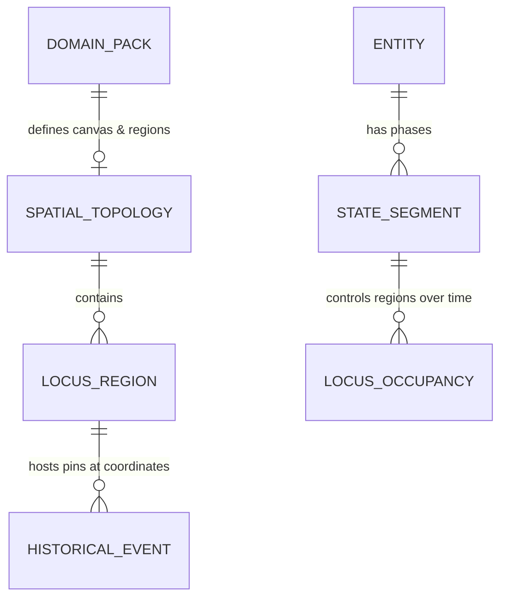

# [오라클 일반화] 공간/위상 캔버스(Spatial Topology Canvas) 및 한반도·동아시아 고정 영토 지도 구현 계획서

형님! 아주 훌륭하고 핵심적인 지적을 주셨습니다.
역사나 지식의 흐름을 볼 때, 텍스트와 시간축 스트림(Time-River)만으로는 **"도대체 당시에 그 국가가 어디에 있었고, 영토 판도가 어떻게 맞닿아 있었으며, 어디서 싸웠는가?"**라는 공간적 직관(Spatial Intuition)을 한 번에 느끼기 어렵습니다.

형님의 말씀대로 **"한반도사에서는 만주 일부(남단) + 한반도 전역 + 일본 일부(북서단)의 고정된 지도상에 영토와 거점을 표시"**하면서도, 추후 물리학사(에너지-크기 스케일 위상도)나 유럽사 등 어떤 주제에서도 동일하게 재사용할 수 있도록 **오라클 규격(Oracle Contract)으로 일반화**하여 프레임워크에 정식 편입하는 마스터 계획서를 수립했습니다.

---

## 1. 오라클 일반화 설계 철학: 왜 '공간/위상 캔버스(Spatial Topology)'인가?

도메인마다 '무대(공간)'의 성격이 다릅니다:
- **역사 도메인 (한반도사, 유럽사 등)**:
  - 무대 = **지리적 지도 (Geographical Map)** (위도/경도 또는 SVG 지리적 윤곽선)
  - 요소 = 영역/군현/거점(`LocusRegion`), 수도(`Capital Pin`), 주요 격전지(`Battle Pin`)
- **과학/물리학 도메인 (물리학사 등)**:
  - 무대 = **개념 위상 스케일 맵 (Scale-Phase Map)** (X축: 에너지/온도, Y축: 시공간 크기(미시~거시))
  - 요소 = 이론의 유효 지배 영역(예: 양자역학 영역, 일반상대성 영역, 고전역학 영역)
- **컴퓨팅/기술 도메인**:
  - 무대 = **시스템 아키텍처 맵 (System Architecture Canvas)** (하드웨어, OS, 런타임, 앱 레이어)

이 모든 것을 오라클 수준에서 단 하나의 엄밀한 계약인 **`SpatialTopologyContract`**로 통합합니다.

---

## 2. 오라클 데이터 스키마 확장 (`SpatialTopology` 계약)



### ① `SpatialTopology` (캔버스 및 영역 정의)
```typescript
export interface LocusRegion {
  /** 규격: loc_<packCode>_<slug> (예: loc_ea_manchuria_south, loc_ea_han_river, loc_ea_kyushu) */
  id: string;
  name: string;
  description: string;
  /** SVG 지도 배경 렌더링용 Path 데이터 또는 다각형 좌표 */
  boundarySvgPath: string;
  /** 거점/라벨 표시 기준 중심 좌표 (x: 0~1000, y: 0~1000 상대 좌표) */
  centerCoord: { x: number; y: number };
}

export interface SpatialTopology {
  /** 캔버스 유형: 'GEOGRAPHIC_MAP' (지리 지도) | 'CONCEPTUAL_TOPOLOGY' (위상/개념도) */
  canvasType: 'GEOGRAPHIC_MAP' | 'CONCEPTUAL_TOPOLOGY';
  viewBox: { width: number; height: number };
  baseMapSvgPath: string; // 바다, 해안선, 국경선 등 고정 배경 벡터
  regions: LocusRegion[];
}
```

### ② `StateSegment`의 영토/지배권 점유 확장 (`LocusOccupancy`)
각 시대별 상태 구간(`StateSegment`)에 해당 시기 장악하고 있던 지역(`occupancies`)과 수도/중심지 좌표를 연결합니다:
```typescript
export type ControlLevel = 'DOMINANT' (완전 지배) | 'INFLUENTIAL' (세력권/영향력) | 'CONTESTED' (각축/전쟁터);

export interface LocusOccupancy {
  regionId: string;
  level: ControlLevel;
}

// StateSegment에 추가되는 필드:
// - capitalLocusId?: string; // 수도 소재지 Locus ID
// - capitalCoord?: { x: number; y: number }; // 수도 정밀 핀 좌표
// - occupiedRegions?: LocusOccupancy[]; // 장악 지역 목록
```

### ③ `HistoricalEvent` 및 `Transition`의 지도 핀 연동
- 주요 사건(공산 전투, 고창 전투, 일리천 전투, 천문령 전투, 백강 전투 등)에 `{ x, y }` 지도 좌표를 부여하여, 연도 슬라이더 스크러빙 시 **"그 시점에 발생한 역사적 사건이 지도 위에서 번쩍이며(Pin Drop)"** 표시됩니다.

---

## 3. 한반도 역사 도메인의 고정 지도(Map) 스코프

형님께서 요청하신 범위를 정확히 반영하여 **만주 남부(요동/백두산/동모산) ~ 한반도 전역 ~ 일본 서북부(규슈/세토내해/아스카)**를 아우르는 고정밀 벡터 지도를 구축합니다.

| 권역 ID | 명칭 | 포함 지역 및 역사적 역할 |
| :--- | :--- | :--- |
| `loc_ea_manchuria_liaodong` | **만주 남부 · 요동 권역** | 요동성, 안시성, 동모산(발해 건국지), 상경 홀한성 방면, 거란 남하 루트 |
| `loc_ea_north_pyeongyang` | **한반도 북부 (평양 · 패서)** | 평양성(고구려 수도/고려 서경), 대동강, 패서 13진, 원산만 |
| `loc_ea_central_han_river` | **한반도 중부 (송악 · 철원 · 한강)** | 개경(송악), 철원(태봉 수도), 한양/한성(백제 한성), 예성강 해상로 |
| `loc_ea_southwest_honam` | **한반도 남서부 (호남 · 완산 · 나주)** | 웅진/사비(백제), 무진주(광주), 완산주(후백제 전주), 나주(왕건 수군 기지) |
| `loc_ea_southeast_yeongnam` | **한반도 남동부 (영남 · 금성 · 가야)** | 금성(경주, 신라 천년 수도), 대가야(고령), 금관가야(김해), 대구(공산), 안동(고창), 선산(일리천) |
| `loc_ea_tamna_jeju` | **도서 해양권 (탐라 · 제주)** | 탐라국 해상 기지 |
| `loc_ea_japan_west` | **일본 열도 서북부 (규슈 · 기나이)** | 다자이후(규슈 방어선), 백강(금강구 출병), 아스카/나라/헤이안쿄 |

---

## 4. UI 레이아웃 개편: 산만함을 해소하는 "중앙 집중 인터랙티브 맵 뷰"

기존에 하단에 카드 형태로 분산되어 있던 시점 스냅샷 정보를 **지도 중심의 일체형 대시보드**로 재편합니다:

```text
┌──────────────────────────────────────────────────────────────────────────────┐
│ [TopControlBar] 도메인 팩 스위처 | 요인별 필터 (정치·군사·경제 등) | 계약 검증 배지   │
├──────────────────────────────────────────────────────────────────────────────┤
│ [TimeScrubber] 연도 슬라이더 (400년 ──▶ 901년 ──▶ 936년 ──▶ 1000년) | 재생/정지   │
├──────────────────────────────────────────────────────────────────────────────┤
│ [TimeRiverCanvas] (산키 시간 강줄기: 신라 ─┬─ 후백제 ──┬─▶ 고려 후삼국 통일)          │
├──────────────────────────────────────┬───────────────────────────────────────┤
│ [SpatialTopologyCanvas] 고정 영토 지도 뷰│ [CausalLineageTracer] & [Evidence]   │
│ - 만주 남부, 한반도, 일본 열도 서부 벡터 지도 │ - [1단계: 선행 분열 원인]                │
│ - 현재 연도(t)에 맞춰 각 영토 색상이 실시간 변경│ - [2단계: 내부 국호·수도 변천]            │
│ - 수도 핀 (금성, 완산주, 철원, 개경)      │ - [3단계: 후속 통합 결과]                │
│ - 격전지 핀 (공산, 고창, 일리천, 백강 등) │ - 『삼국사기』, 『고려사』 등 1차 사료 카드 │
│ - 영역 클릭 시 해당 지역 역사 상태 즉시 포커스│                                       │
└──────────────────────────────────────┴───────────────────────────────────────┘
```

---

## 5. 형님께 드리는 추가 제안 (Proactive Enhancements)

> [!TIP]
> **제안 1: "타임머신 영토 스크러빙 (Territory Time-Scrubbing)"**
> 슬라이더를 889년(신라 단일 영토)에서 900년(후백제 전라도 분열 빨강/분홍 점유), 901년(태봉 중북부 점유 보라색), 918년(고려 건국 에메랄드색), 935년(신라 귀부로 영남 고려 편입), 936년(후백제 멸망으로 전 국토 고려 단일화)으로 드래그할 때, **지도의 영토 색상이 마치 타임랩스처럼 한눈에 바뀌도록 구현**합니다. 성능 저하가 없는 경량 순수 SVG 벡터 기법을 적용합니다.

> [!TIP]
> **제안 2: "결전지 핀포인트 툴팁 & 인과 연동 (Battle Pin Click-Through)"**
> 지도 위에 표시된 ⚡ 사건 핀(예: 대구 공산, 안동 고창, 선산 일리천, 금강 백강)을 클릭하면, 우측의 인과 추적기와 사료 패널이 즉각 해당 사건의 사료(『삼국사기』 원문)로 스크롤되며 지도와 지식이 1:1로 결합됩니다.

> [!TIP]
> **제안 3: "물리학사 팩을 위한 2D 위상 맵 (Scale Topology Map)"**
> 물리학 팩으로 전환하면 지도가 아닌 **[가로축: 에너지/속도(정지~광속), 세로축: 공간 스케일(미시 소립자~거시 우주)] 2차원 위상도**가 나타나며, 뉴턴 역학 영역, 상대성이론 영역, 양자역학 영역, 표준모형 영역이 어떻게 영토를 넓혀왔는지 동일한 엔진으로 렌더링됩니다.

---

## 6. 단계별 작업 계획 (Phased Execution)

### Phase 1: 오라클 계약 및 타입 명세 업데이트
1. `important/02_DATA_SCHEMA_CONTRACT.md` 및 `important/04_VIEW_ENGINE_CONTRACT.md`에 `SpatialTopology`, `LocusRegion`, `LocusOccupancy` 오라클 계약 명세 추가.
2. `src/contracts/timeline.contract.ts`에 관련 인터페이스 및 좌표 규격 정의.

### Phase 2: 도메인 팩 데이터에 공간/지도 데이터 바인딩
1. `src/packs/east-asia-history/topology.ts` 신설 (만주 남부, 한반도 전역, 일본 규슈/서일본을 아우르는 정밀 SVG 베이스 지도 및 7대 권역 정의).
2. `src/packs/east-asia-history/segments.ts` 및 `eventsAndEvidences.ts`에 시기별 영토 점유와 수도/격전지 좌표 바인딩.
3. `src/packs/physics-history/topology.ts` 신설 (물리학용 2D 스케일 위상 맵 정의).

### Phase 3: 고성능 SVG 공간 캔버스 컴포넌트 구현
1. `src/components/SpatialTopologyCanvas.tsx` 구현 (Zero-Blur 고성능 SVG, 호버/클릭 인터랙션, 수도/사건 핀, 영토 색상 매핑).
2. `src/App.tsx` 레이아웃을 2열 분할 대시보드(좌측: 직관적 지도, 우측: 인과 사료 스토리보드)로 재구성.

### Phase 4: 검증, 빌드 및 문서 최신화
1. `validatePacks.ts` 검증기 통과 확인 (`12/12` 및 공간 무결성).
2. 프로덕션 빌드 확인 및 `APP_MAP.md`, `docs/test_results.txt` 업데이트.

---

## 7. 형님의 확인 및 승인 요청

형님, 위 계획서의 구조(오라클 공간 위상 계약 확립 + 만주남부·한반도·일본서부 고정 영토 지도 + 영토 타임랩스 및 결전지 핀 연동)가 마음에 드시는지 검토 부탁드립니다!
진행해도 좋다고 판단되시면 아래의 **Proceed** 버튼을 눌러주시면 즉시 착수하겠습니다!
