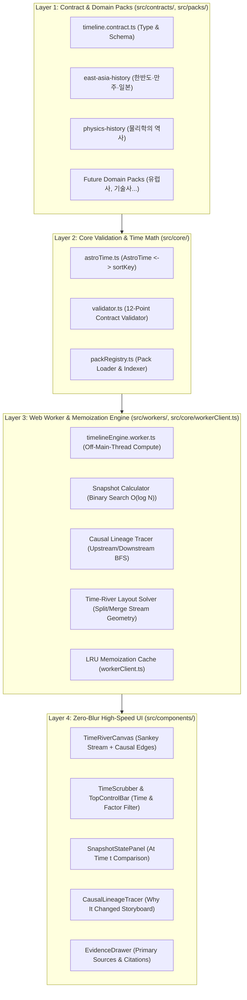

# 🏗️ 01. 시스템 아키텍처 및 고성능 엔지니어링 계약
**(System Architecture, Worker Pipeline & Performance Contract)**

> **문서 번호**: `01_SYSTEM_ARCHITECTURE`  
> **상위 오라클**: `00_ORACLE_TIMELINE_FRAMEWORK.md`

---

## 1. 4-레이어 아키텍처 (4-Layer Architecture)

시스템은 철저하게 분리된 4개의 단방향 레이어로 구성된다. 하위 레이어는 상위 레이어를 알지 못한다.



---

## 2. 디렉토리 및 모듈 구조 규격

```text
timelines/
├── important/                          # [ORACLE] AI가 항상 숙지해야 하는 절대 계약 문서
│   ├── 00_ORACLE_TIMELINE_FRAMEWORK.md
│   ├── 01_SYSTEM_ARCHITECTURE.md
│   ├── 02_DATA_SCHEMA_CONTRACT.md
│   ├── 03_AI_AUTHORING_PLAYBOOK.md
│   └── 04_VIEW_ENGINE_CONTRACT.md
├── docs/                               # 구현 계획서, 검증/테스트 리포트 보관
│   ├── implementation_plan.md
│   ├── test_results.txt
│   └── history/                        # 7일 경과 계획 문서 아카이브
├── APP_MAP.md                          # 프로젝트 전체 파일 및 인터페이스 실시간 지도
├── scripts/
│   └── validatePacks.ts                # CLI 기반 도메인 팩 무결성 검증 스크립트
└── src/
    ├── contracts/                      # [Contract Layer] 순수 타입 및 인터페이스 계약
    │   ├── timeline.contract.ts
    │   └── worker.contract.ts
    ├── core/                           # [Core Layer] 시간 연산, 검증기, 워커 클라이언트(캐시)
    │   ├── astroTime.ts
    │   ├── validator.ts
    │   ├── layoutEngine.ts
    │   └── workerClient.ts
    ├── workers/                        # [Worker Layer] 백그라운드 연산 전담 워커
    │   └── timelineEngine.worker.ts
    ├── packs/                          # [Data Packs] 도메인별 타임라인 데이터 팩
    │   ├── index.ts                    # 등록된 모든 도메인 팩 레지스트리
    │   ├── east-asia-history/          # 도메인 팩 1: 한반도·만주·일본 역사
    │   │   ├── index.ts
    │   │   ├── axes.ts
    │   │   ├── entities.ts
    │   │   ├── segments.ts
    │   │   ├── transitions.ts
    │   │   └── eventsAndEvidences.ts
    │   └── physics-history/            # 도메인 팩 2: 물리학의 역사 (범용성 입증 팩)
    │       ├── index.ts
    │       ├── axesAndEntities.ts
    │       └── transitionsAndEvidences.ts
    └── components/                     # [UI Layer] 단일 책임 원칙의 고성능 뷰 컴포넌트
        ├── TopControlBar.tsx
        ├── TimeScrubber.tsx
        ├── TimeRiverCanvas.tsx
        ├── SnapshotStatePanel.tsx
        ├── CausalLineageTracer.tsx
        ├── EvidenceDrawer.tsx
        └── ValidationBadgeModal.tsx
```

---

## 3. Web Worker 연산 및 메모이제이션 계약

대용량 역사/과학사 데이터(수백 개의 국가/학파, 수천 개의 상태 구간과 사건)에서도 60fps 스크러빙을 보장하기 위해 다음 전략을 강제한다.

### 3.1. 사전 정렬 및 인덱스 구축 (`INIT_PACK`)
도메인 팩이 로드되면 워커는 즉시 다음 인덱스를 메모리에 구축한다:
1. `entityById: Map<string, Entity>`
2. `segmentsByEntityId: Map<string, StateSegment[]>` — `startTime.sortKey` 기준 오름차순 정렬 완료.
3. `transitionsBySourceId: Map<string, Transition[]>` 및 `transitionsByTargetId: Map<string, Transition[]>` — 인과 그래프 순방향/역방향 인접 리스트(Adjacency List).
4. `evidenceById: Map<string, Evidence>`

### 3.2. 시점 스냅샷 연산 (`COMPUTE_SNAPSHOT`)
사용자가 타임라인 슬라이더를 움직여 연도 $t$를 지정하면:
- 각 `Axis`별로 해당 시점 $t$에 활성화된(`startSortKey <= tSortKey && tSortKey <= endSortKey`) 모든 `Entity`를 추출한다.
- 각 활성 `Entity`의 현재 `StateSegment`를 **이진 탐색(Binary Search)**으로 $O(\log K)$에 조회한다.
- 시점 $t$ 전후 근접 구간($t \pm \Delta$)에서 발생한 핵심 `Transition`(변화)과 `HistoricalEvent`(사건)를 즉시 반환한다.
- **LRU 메모이제이션**: `workerClient.ts`는 `(packId, year, activeFactorFilterKey)`를 조합한 캐시 키로 최대 256개의 스냅샷 결과를 캐싱하여, 이미 지나간 연도를 다시 스크러빙할 때 워커 왕복 지연 시간(Latency)조차 `0ms`로 만든다.

### 3.3. 전후 인과 계보 추적 (`TRACE_CAUSAL_LINEAGE`)
사용자가 특정 `Entity`(예: `후백제`, `고려`) 또는 특정 `Transition`(예: `후삼국 통일`)을 선택하면:
- **Upstream (선행 원인 추적)**: `transitionsByTargetId`를 역방향 BFS 탐색하여 "어떤 국가에서 분열·파생되었고 왜 탄생했는가"의 조상 트리(Ancestors)와 모든 전환 간선을 수집한다.
- **Downstream (후속 결과 추적)**: `transitionsBySourceId`를 정방향 BFS 탐색하여 "이후 어떤 국가로 흡수·통합되었거나 어떤 영향을 남겼는가"의 후손 트리(Descendants)와 전환 간선을 수집한다.
- 이 결과 역시 `(packId, targetType, targetId, factorFilterKey)` 키로 완벽히 메모이제이션된다.

---

## 4. UI 성능 및 코드 품질 절대 규칙

1. **Zero-Blur 원칙**: CSS에서 `backdrop-filter`, `filter: blur()`, 과도한 `box-shadow` 스프레드를 일절 금지한다. 모든 패널과 오버레이는 하드웨어 가속 친화적인 불투명 배경색(`#0f141c`, `#161d2a` 등)과 명확한 보더(`#263248`)만 사용한다.
2. **파일 크기 상한 (< 900 Lines)**: 모든 파일은 900줄 미만을 유지한다. 도메인 팩 데이터 역시 한 파일에 몰아넣지 않고 `axes.ts`, `entities.ts`, `segments.ts`, `transitions.ts`, `eventsAndEvidences.ts`로 분할하여 관리한다.
3. **`APP_MAP.md` 동기화**: 새로운 파일이나 인터페이스가 추가·변경될 때마다 `APP_MAP.md`에 즉시 반영한다.
